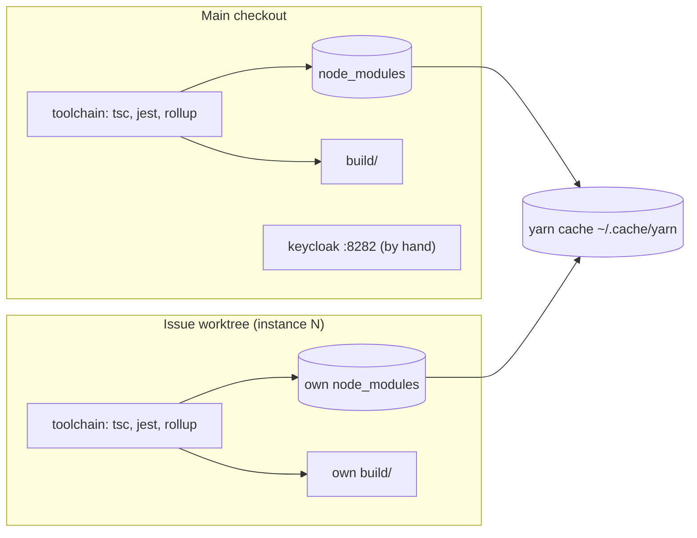

# Stack: kantorv/react-keycloak-provider

Written by jst-survey on 2026-11-25 from `development` at `aeaed63`.

## What it is

`react-keycloak-provider` is a small npm library: a React context provider and a
`useKeycloak()` hook around `keycloak-js`. Its source (`src/`) is type-checked by `tsc`,
unit-tested with Jest through `react-scripts test` (with `keycloak-js` mocked), and
bundled by Rollup into `build/` (CJS, ESM and one `.d.ts`). Nothing in it listens on a
port. A real Keycloak (Docker, `ci/`) and a Selenium login/logout test run in CI against
the packed tarball, installed into a throwaway create-react-app demo app. A Storybook
setup exists but doesn't build today (see *Notes*).

## Project type

| | Value | Evidence |
| -- | -- | -- |
| Repo layout | `single` | the `repo_strategy` row reads `single`. One package, no members |
| Run pattern | `toolchain` | a library: an instance is its own `node_modules` and `build/`, with nothing listening. The Keycloak compose service in `ci/` serves only the CI E2E test, which hard-codes `localhost:3000` and `localhost:8282`, so an instance doesn't run it *(assumed)* |

## Components

| Component | What it does | Runs as | Listens on (main) | Ready when |
| -- | -- | -- | -- | -- |
| deps | the dev toolchain (React 19, Rollup, Jest via react-scripts 5, TypeScript, Storybook) and `keycloak-js` | `yarn install --frozen-lockfile` (yarn 1, `yarn.lock` is the lockfile of record) | — | exits 0 and `node_modules/.bin/rollup` exists |
| library build | bundles `src/index.ts` → `build/index.js`, `build/index.es.js`, `build/index.d.ts` | `yarn build` (`rollup -c`) | — | exits 0 and `build/index.d.ts` exists |
| unit tests | Jest suite for the provider, `keycloak-js` mocked | `CI=true yarn test --watchAll=false` (plain `yarn test` is watch mode) | — | exits 0 |
| storybook | component gallery against a real Keycloak at `localhost:8282` | `yarn storybook` | :6006 | not run by the stack: the build fails today *(assumed)* |
| keycloak | Keycloak 26.4 dev mode, realm `demo` imported from `ci/demo-realm-with-react-client-localhost-3000-export.json`, demo user created through the Admin API | by hand, `cd ci && bash run.sh` (Docker Compose, container name `keycloak`) | :8282 | the log shows `Running the server in development mode` (`ci/wait_for_docker.sh`). Not run by the stack *(assumed)* |
| E2E test | login → redirect → logout through a CRA demo app that installs the packed tarball | CI only (`.github/workflows/tests.yml`), `ci/tests/tests.py` | demo app :3000 | not run by the stack *(assumed)* |

## Resources in two places

| Resource | Main checkout | Issue worktree (instance N) | Why |
| -- | -- | -- | -- |
| `node_modules` | installed (`yarn install`) | **own copy**, installed from the worktree's own `yarn.lock` with `yarn install --frozen-lockfile` (≈15 s from a warm yarn cache, ≈490 MB) | a branch may change `package.json`/`yarn.lock`. Not hard-linked from main, because Jest/Babel/Storybook write into `node_modules/.cache`, and a hard-linked file rewritten in place would change main's copy too |
| yarn cache (`~/.cache/yarn/v6`) | used | **shared** | content-addressed by `name@version` and only added to by an install, so a copy can't break another |
| `build/` | generated by `yarn build` | **own copy**, generated in the worktree | it is that branch's bundle. It is git-ignored and never committed |
| `coverage/`, Jest cache | generated when tests run | **own copy** (`coverage/` in the worktree. Jest's cache is in the OS temp dir, keyed by project path) | per-branch output |
| Keycloak (`ci/`, :8282, container `keycloak`) | started by hand with `cd ci && bash run.sh` when someone wants it. Not running at survey time | **absent** *(assumed)* | nothing an instance runs talks to it: the unit tests mock `keycloak-js`, Storybook doesn't build, and the E2E test is CI-only. An instance must **not** run `ci/run.sh`: it does `docker compose down` and `up --force-recreate` on the fixed container name `keycloak` and the fixed host port 8282, which would replace main's Keycloak |
| Storybook (:6006) | `yarn storybook` by hand. The build fails today | **absent** *(assumed)* | it doesn't build (see *Notes*). Even once fixed, an instance's Storybook on another port would be refused by the realm, whose `react-client` allows only origins `localhost:3000` and `localhost:6006` (and `127.0.0.1`) |
| E2E demo app (:3000), Chrome + chromedriver (`/tmp/chrome-linux64`, `/tmp/chromedriver-linux64`) | absent locally (the E2E runs in CI) | **absent** | CI runs the E2E on every push to `feature/*`, `hotfix/*`, `release/*`, `fix/*`. `ci/tests/tests.py`, `ci/tests/index.tsx` and the realm hard-code ports 3000 and 8282 |
| Env files | none for the app. `ci/.env.keycloak.ci` (Keycloak bootstrap admin) is **tracked**, not ignored | comes with the checkout. Nothing to copy in | the only ignored env file is `.jst/jira-sdlc-tools.local.env`, the toolkit's own, which isn't the app's |
| Ports | none | **none** | nothing an instance runs listens on a port |

## Diagram

## What the stack needs from the host

- **Ports per instance:** none. **Subnet:** none. **Names it makes:** none. No
  containers, networks, volumes or compose projects.
- **How many instances at once:** limited only by disk, at about 0.5 GB of
  `node_modules` per worktree.
- **Prerequisites:** Node 24 (CI's `node-version: '24'`. The host has v24.22.2) and
  yarn 1.x (the host has 1.22.22). Docker with Compose v2+, `curl` and `jq` are needed
  only to run Keycloak by hand in the main checkout.
- **Shared services the main checkout must have running:** none.
- **What `./stack start --instance N` does:** `yarn install --frozen-lockfile`, then
  `yarn build`. Ready when both exit 0 and `build/index.d.ts` exists. Nothing stays
  running, so there is nothing to stop. Teardown is the worktree's own removal.
- **Main checkout (`./stack` with no `--instance`):** the same two steps. It doesn't
  start Keycloak: that stays `cd ci && bash run.sh`, by hand.
- No `stack.d/resources.conf` exists.

## What the executor can check with nothing running

Everything the repo checks locally works with nothing running, once `yarn install`
has run (verified at `aeaed63`):

- `npx tsc -p .` (type check only, `noEmit: true`): passes.
- `CI=true yarn test --watchAll=false`: passes, 1 suite and 12 tests (`keycloak-js` is mocked).
- `yarn build`: passes. Its Rollup "Unresolved dependencies: keycloak-js" warning on the
  `.d.ts` pass is expected (it's a runtime dependency, kept external).
- `npx eslint src --ext .ts,.tsx` (no `lint` script. The config is `eslintConfig` in
  `package.json`): **fails today with 3 errors that are already on `development`**.
  Two are `storybook/no-renderer-packages` in `src/stories/*.stories.tsx` and one is
  `testing-library/render-result-naming-convention` in `KeycloakProvider.test.tsx:180`.
  Judge a branch by the errors it adds.

Nothing needs a service. The real-Keycloak login check is the CI E2E suite on push.

## Changes to the existing stack

none. There is no `./stack`, `stack.d/` or `.jst/bootstrap.sh`.

## Before jst-stack

none

## Open questions

none. The decisions this survey couldn't ask about are in the tables above, marked
*(assumed)*: an instance runs no Keycloak, no Storybook and no E2E. Edit them in the PR
if any is wrong.

## Notes

- **Storybook doesn't build.** `storybook build` fails with `SB_CORE-SERVER_0004`
  (`No matching export … "Icons"` from `@storybook/addon-toolbars`): `package.json` mixes
  Storybook 8.6 addons (`addon-essentials`, `addon-interactions`, `blocks`, `test`)
  with Storybook 10.4 core. Also, `src/stories/Loading.stories.tsx` imports a
  `./Loading` that doesn't exist (CLAUDE.md flags this too). If Storybook is fixed and
  wanted per instance, the instance will need a port and a realm whose `react-client`
  allows its origin. That would be a re-survey.
- **CLAUDE.md is out of date about `ci/.env.keycloak.ci`.** It says the file is
  git-ignored and has to be created. It is tracked, so it comes with every checkout.
  The values are deliberately not read or recorded here.
- **CLAUDE.md is out of date about releases.** It says `release.yml` publishes on every
  merge to `development`. Since RKP-4, a release is cut explicitly
  (`cut-release.yml`, `release/X.Y.Z` → `main`). See `docs/SDLC.md` and
  `docs/RELEASING.md`.
- **The root `run.sh` isn't a run script.** It runs `npx sb init` and
  `npm-check-updates --upgrade`, which are leftover scaffolding commands. Neither the
  stack nor the executor should run it.
- **Host port 3000 is already taken** by another process on this machine (not this
  project). A by-hand local E2E run, whose demo app wants :3000, would collide.
- `.gitignore` doesn't list `storybook-static/` (the default `yarn build-storybook`
  output).
- The main checkout's local `development` was 10 commits behind `origin/development` at
  survey time, with nothing ahead. Its `node_modules` is installed from an older
  `yarn.lock`.

## Changes

- 2026-11-25 jst-survey: written.
